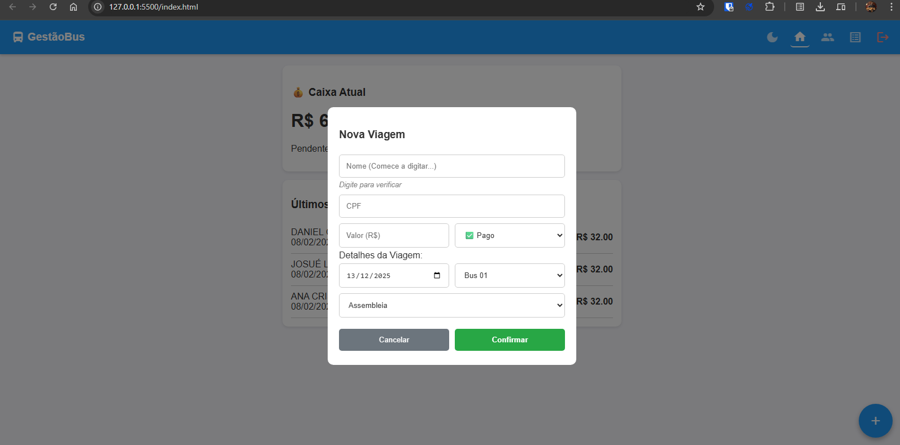
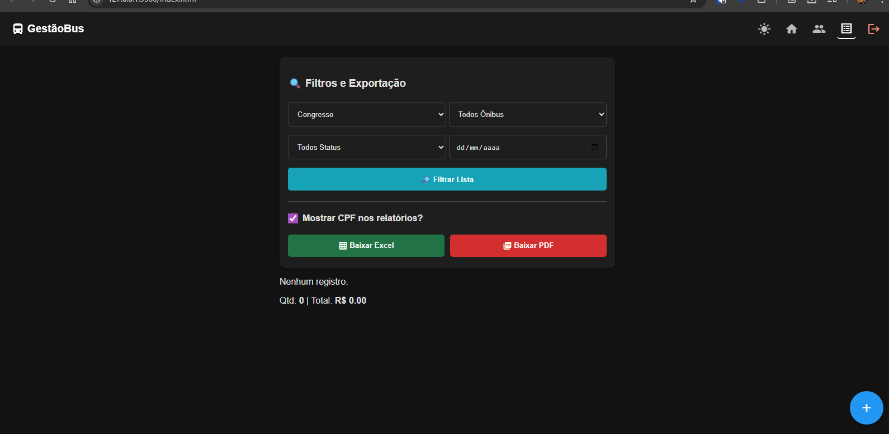

 # 🚍 GestãoBus Pro

Sistema web completo para gestão de viagens, excursões e controle de passageiros. Desenvolvido para facilitar a organização de eventos como Assembleias e Congressos, com foco em agilidade no cadastro e controle financeiro.


## 🎯 Funcionalidades Principais

### 1. 📝 Gestão de Passageiros
* **Cadastro Rápido:** Formulário otimizado para lançar passageiros em segundos.
* **Status Financeiro:** Controle visual de quem está **Pago (Verde)** ou **Pendente (Vermelho)**.
* **Edição e Exclusão:** Botões rápidos de lápis e lixeira para corrigir erros.

### 2. 🧠 Base de Clientes Inteligente
* **Cadastro Automático:** Opção de salvar passageiros frequentes na base de dados durante o lançamento da viagem.
* **Autopreenchimento:** Ao digitar o nome de um cliente conhecido, o sistema preenche o CPF automaticamente.
* **Gestão da Base:** Aba dedicada para visualizar, editar e excluir clientes fiéis.

### 3. 📊 Relatórios e Exportação
* **Filtros Avançados:** Filtre por Evento, Número do Ônibus, Status de Pagamento ou Data.
* **Controle de Privacidade:** Opção (Checkbox) para **ocultar ou mostrar o CPF** nas listas geradas.
* **Exportação Excel (.csv):** Gera planilhas formatadas para o padrão brasileiro (acentos e separadores corretos).
* **Impressão/PDF:** Layout limpo e profissional, ideal para listas de embarque (Manifesto).

### 4. 💻 Interface e Usabilidade
* **Caixa em Tempo Real:** Dashboard que soma o total arrecadado e o total pendente instantaneamente.
* **Design Responsivo:** Funciona perfeitamente no computador e no telemóvel.
* **Modo Escuro (Dark Mode):** Ícone de Sol/Lua para alternar temas e descansar a visão.
* **Barra "Slim":** Navegação fixa e compacta no topo da tela.

---

## 🛠️ Tecnologias Utilizadas

* **HTML5 & CSS3:** Estrutura e estilização moderna (Flexbox, Variáveis CSS).
* **JavaScript (Vanilla):** Lógica de negócios, manipulação do DOM e exportação de arquivos.
* **Firebase (Google):**
    * **Firestore:** Banco de dados NoSQL em tempo real.
    * **Authentication:** Sistema de Login seguro.

---

## 🚀 Criar uma réplica independente para outro usuário

Este manual cria **outro repositório na mesma conta GitHub**, com as mesmas funcionalidades do GestãoBus Pro, mas conectado a **outro projeto Firebase**, com outro login e banco inicialmente vazio.

O repositório de origem é [santos1513lopes-lgtm/ControleViagens](https://github.com/santos1513lopes-lgtm/ControleViagens). Os passos abaixo devem ser executados na **cópia e no novo projeto Firebase**. O aplicativo original pode continuar funcionando com seus dados atuais.

### O que será separado

| Item | Aplicativo atual | Nova cópia |
| --- | --- | --- |
| Repositório GitHub | `ControleViagens` | Outro nome, por exemplo `ControleViagens-NovoUsuario` |
| Projeto Firebase | Projeto atual | Um projeto novo, com outro `projectId` |
| Banco Firestore | Banco atual | Banco `(default)` do projeto novo |
| Usuário Authentication | Cadastro atual | Cadastro criado no projeto novo |
| Viagens, clientes e despesas | Dados atuais | Começa sem registros |
| Funcionalidades | GestãoBus Pro | As mesmas, copiando os arquivos |

**Importante sobre o nome do banco:** neste aplicativo, `firebase.firestore()` usa o banco **`(default)`**. Para separar os dados sem alterar a lógica do programa, crie **um novo projeto Firebase** e mantenha `(default)` dentro dele. Apenas mudar o nome do repositório, o nome exibido do aplicativo ou o apelido de um app Web no projeto antigo não separa os dados. Criar um segundo banco com nome diferente dentro do projeto atual exigiria adaptar o código.

A ligação funciona assim: **GitHub Pages entrega os arquivos → o navegador executa `app.js` → `firebaseConfig` identifica o novo Firebase**. Não é necessário conectar sua conta GitHub ao console Firebase ou fornecer uma chave privada.

### 1. Baixar os arquivos do aplicativo atual

1. Abra [ControleViagens](https://github.com/santos1513lopes-lgtm/ControleViagens).
2. Clique no botão **Code / Código → Download ZIP / Baixar ZIP**.
3. Extraia o ZIP em uma pasta local, por exemplo `ControleViagens-NovoUsuario`.
4. Dentro dela devem estar:

```text
index.html
app.js
style.css
README.md
screenshots/
```

`index.html`, `app.js` e `style.css` são os arquivos necessários à interface. `screenshots/` contém as imagens do README. Baixar os arquivos do GitHub **não copia os registros do Firestore nem os usuários do Authentication**.

Ainda não publique nem use a cópia com a configuração Firebase antiga. Primeiro faça a substituição descrita no passo 6.

### 2. Criar o novo repositório na mesma conta GitHub

1. Entre na sua conta GitHub.
2. Clique em **+ → New repository / Novo repositório**.
3. No proprietário, mantenha sua conta, por exemplo `santos1513lopes-lgtm`.
4. Escolha um nome diferente, por exemplo:

```text
ControleViagens-NovoUsuario
```

5. Para seguir a publicação pelo GitHub Pages de um repositório público, selecione **Public / Público**. A disponibilidade de Pages em repositórios privados depende do plano GitHub.
6. Como você enviará os arquivos baixados, não precisa gerar outro README, licença ou `.gitignore` nesta etapa.
7. Clique em **Create repository / Criar repositório**.

Neste momento, deixe o novo repositório aguardando os arquivos. As credenciais de login e os registros pessoais não devem ser colocados nele.

### 3. Criar um novo projeto no Firebase

1. Abra o [Console Firebase](https://console.firebase.google.com/).
2. Volte à lista de projetos e clique em **Adicionar projeto / Criar projeto**. Não entre nas configurações do projeto usado pelo aplicativo original para reaproveitar seu banco.
3. Dê um nome ao novo projeto, por exemplo `GestaoBus Novo Usuario`.
4. Confira o **ID do projeto** gerado pelo Firebase. Ele deve ser diferente do projeto atual. O ID é único e não pode ser alterado depois; o nome de exibição pode ser diferente dele.
5. Google Analytics não é necessário para as funcionalidades atuais; se não precisar dele, pode deixar desativado.
6. Conclua a criação e confirme, no topo do console, que está no **projeto novo**.

O novo projeto pode ser criado na sua conta Google ou na conta Google da pessoa que administrará essa cópia. A conta Google que administra o projeto não precisa ser o mesmo e-mail usado para entrar no aplicativo.

### 4. Registrar o aplicativo Web e copiar sua configuração

1. Na visão geral do novo projeto, clique no ícone **Web `</>`**.
2. Se o projeto já estiver aberto em outra tela, use **engrenagem → Configurações do projeto → Geral → Seus aplicativos → Adicionar aplicativo → Web**.
3. Informe um apelido, por exemplo `GestaoBus-NovoUsuario`.
4. Firebase Hosting não é necessário: a página será publicada no GitHub Pages.
5. Clique em **Registrar app**.
6. Localize o objeto que começa com `const firebaseConfig = {` e copie seus valores.

Se o assistente mostrar opções npm e `<script>`, não instale nem substitua o SDK do aplicativo por esse trecho. A cópia já inclui os arquivos **Firebase compat 9.0.0** no `index.html`; precisamos apenas dos valores de configuração do novo app Web.

Para encontrar esses valores novamente: **Configurações do projeto → Geral → Seus aplicativos → selecione o app Web → Configuração do SDK → Config**. Os nomes das opções podem variar com o idioma do console.

### 5. Ativar o login e criar o usuário no Firebase

#### 5.1 Habilitar e-mail e senha

1. No novo projeto, procure **Authentication** no menu ou na pesquisa de produtos.
2. Clique em **Começar / Get started**, se aparecer.
3. Abra **Método de login / Sign-in method**.
4. Escolha **E-mail/senha / Email/Password**.
5. Ative a primeira opção de **E-mail/senha** e salve. A opção de link por e-mail sem senha não é necessária para o código atual.

#### 5.2 Cadastrar o usuário que acessará a cópia

1. Em **Authentication → Usuários / Users**, clique em **Adicionar usuário / Add user**.
2. Informe o e-mail que a pessoa usará e uma senha que atenda à política configurada no projeto.
3. Salve e copie o **UID do usuário** exibido no cadastro. Ele é um identificador, não o e-mail nem a senha.
4. Guarde esse UID para o passo 7, no qual você o colocará nas regras do Firestore.

Não é preciso criar uma conta Gmail nova: o login do aplicativo usa o cadastro de e-mail/senha do Firebase. Mesmo que um e-mail já exista no projeto antigo, ele precisa ser cadastrado no projeto novo. Não reutilize o UID do projeto antigo.

O aplicativo atual possui **Entrar**, mas não possui tela de criação de conta ou recuperação de senha. A administração dos usuários é feita no console Firebase. Não escreva e-mail/senha de acesso no README ou em `app.js`.

### 6. Trocar a conexão no `app.js` da cópia

Abra o **`app.js` da pasta copiada**, usando um editor de texto. Logo no começo, localize `const firebaseConfig = { ... };`.

**Substitua todo esse objeto pelos valores copiados do NOVO projeto.** Não basta mudar somente `projectId` e não mantenha os outros valores do projeto anterior.

Este é o modelo de substituição; troque os seis textos entre aspas pelos valores exatos do novo Firebase:

```javascript
const firebaseConfig = {
    apiKey: "COLE_A_API_KEY_DO_NOVO_APP",
    authDomain: "COLE_O_AUTH_DOMAIN_DO_NOVO_APP",
    projectId: "COLE_O_PROJECT_ID_DO_NOVO_PROJETO",
    storageBucket: "COLE_O_STORAGE_BUCKET_DO_NOVO_APP",
    messagingSenderId: "COLE_O_MESSAGING_SENDER_ID_DO_NOVO_APP",
    appId: "COLE_O_APP_ID_DO_NOVO_APP"
};
```

Os seis campos ficam no objeto fornecido pelo Firebase. `storageBucket`, por exemplo, deve ser copiado exatamente como aparece, sem tentar adivinhar o sufixo. O objeto pode conter `measurementId` se Analytics tiver sido habilitado; as funcionalidades atuais não dependem desse campo.

Logo abaixo, **preserve** a inicialização que já existe, uma única vez:

```javascript
firebase.initializeApp(firebaseConfig);
const db = firebase.firestore();
const auth = firebase.auth();
let cacheClientes = [];
```

Esse segundo bloco é uma referência para conferir o resultado; não o cole novamente se já estiver presente. Não acrescente `import { initializeApp } ...`, `const app = initializeApp(...)` ou outro `<script>` ao `app.js`: esses exemplos pertencem a outra forma de usar o SDK.

Salve o arquivo. As configurações Web do Firebase identificam o projeto e aparecem no código do navegador; a proteção do banco será feita pelas regras e pelo login. Chaves privadas de conta de serviço, arquivos de administrador e senhas não fazem parte dessa configuração.

### 7. Criar o banco Firestore e publicar as regras

#### 7.1 Criar o banco vazio

1. No **novo projeto**, abra **Firestore Database / Cloud Firestore**. Pode estar em **Bancos de dados e armazenamento** ou ser encontrado pela pesquisa de produtos.
2. Clique em **Criar banco de dados**.
3. Se houver escolha de edição, use **Standard**, com a API normal do Firestore utilizada por este aplicativo.
4. Mantenha o **ID do banco `(default)`**. O que diferencia a cópia é o projeto Firebase novo, não um nome personalizado do banco.
5. Escolha a localização adequada. Para um projeto usado no Brasil, São Paulo pode aparecer como `southamerica-east1`. A localização do banco não pode ser trocada depois.
6. Escolha **modo de produção** quando solicitado e conclua a criação.
7. Abra a aba **Regras / Rules**.

#### 7.2 Código completo para copiar e colar nas Regras

No bloco abaixo, troque **`COLE_UID_DO_NOVO_USUARIO_AQUI`** pelo UID copiado de **Authentication → Usuários**. Mantenha o UID entre aspas.

Depois, no editor de Regras do banco novo, **selecione e substitua todo o conteúdo** pelo bloco completo. Não cole por baixo das regras antigas.

```text
rules_version = '2';
service cloud.firestore {
  match /databases/{database}/documents {
    function usuarioAutorizado() {
      return request.auth != null
        && request.auth.uid == 'COLE_UID_DO_NOVO_USUARIO_AQUI';
    }

    match /viagens/{documentId} {
      allow read, write: if usuarioAutorizado();
    }

    match /clientes/{documentId} {
      allow read, write: if usuarioAutorizado();
    }

    match /despesas/{documentId} {
      allow read, write: if usuarioAutorizado();
    }

    match /{document=**} {
      allow read, write: if false;
    }
  }
}
```

1. Confira que substituiu o UID de exemplo pelo UID real do **projeto novo**.
2. Clique em **Publicar / Publish**.
3. Aguarde a confirmação e a propagação das regras.

As regras autorizam o usuário indicado a ler e gravar as três coleções usadas pelo aplicativo. Outros usuários autenticados não são liberados automaticamente. Não há prazo de 30 dias nessas regras, nem é necessário renová-las mensalmente. Isso não altera as quotas ou condições do plano Firebase.

**Não precisa criar as coleções manualmente.** `viagens`, `clientes` e `despesas` serão criadas no primeiro cadastro correspondente pelo aplicativo. Não precisa criar `authorized_users`, configurar Realtime Database, ativar Storage ou gerar chave de conta de serviço para as funcionalidades atuais.

### 8. Autorizar o domínio do GitHub Pages

1. Ainda no novo projeto, abra **Authentication → Configurações / Settings → Domínios autorizados / Authorized domains**.
2. Se não estiver listado, adicione o domínio da sua conta GitHub Pages:

```text
santos1513lopes-lgtm.github.io
```

3. Salve. Se hospedar em outra conta ou domínio próprio, adicione o domínio correspondente.

Use somente o domínio, **sem** `https://`, barra final ou nome do repositório. Como as duas páginas estão na mesma conta GitHub, o domínio pode ser igual, enquanto o caminho do novo repositório será diferente.

### 9. Enviar os arquivos para o novo repositório

1. Volte ao **repositório novo**, por exemplo `ControleViagens-NovoUsuario`.
2. Se estiver vazio, use **uploading an existing file / carregar um arquivo existente**. Se já tiver arquivos, use **Add file / Adicionar arquivo → Upload files / Enviar arquivos**.
3. Arraste os arquivos e a pasta `screenshots/` de dentro da pasta extraída.
4. Confira se o `app.js` enviado é o arquivo com a configuração do **novo projeto Firebase**.
5. Confira se `index.html`, `app.js` e `style.css` aparecem diretamente na **raiz do repositório**. Não envie somente o ZIP e não deixe todos os arquivos dentro de uma pasta extra.
6. Escreva uma mensagem como `Publica réplica independente do GestãoBus Pro` e clique em **Commit changes / Confirmar alterações**.

Se precisar corrigir depois: abra **`app.js` no repositório novo → ícone de lápis / Editar → altere `firebaseConfig` → Commit changes**. Essa é a parte que você copia do Firebase e retorna ao GitHub para ajustar.

### 10. Publicar a nova página no GitHub Pages

1. No repositório novo, abra **Settings / Configurações → Pages**.
2. Em **Build and deployment → Source**, escolha **Deploy from a branch / Publicar a partir de uma branch**.
3. Em **Branch**, selecione `main` e a pasta **`/ (root)`**.
4. Clique em **Save / Salvar**.
5. Aguarde a publicação terminar. O andamento aparece na aba **Actions / Ações**, no fluxo de publicação do Pages.
6. Volte a **Settings → Pages** e abra o endereço fornecido pelo GitHub.

Com o nome de exemplo, o endereço será:

```text
https://santos1513lopes-lgtm.github.io/ControleViagens-NovoUsuario/
```

Se escolher outro nome, use o endereço exato apresentado pelo GitHub. Não precisa configurar Firebase Hosting ou um servidor Node para essa publicação.

### 11. Entrar e confirmar que os ambientes são independentes

1. Abra a URL **nova**, de preferência em uma janela anônima para não confundir sessões.
2. Entre com o e-mail e a senha criados no **Authentication do novo projeto**.
3. As listas devem começar vazias, pois o novo banco não recebeu registros do aplicativo antigo.
4. Faça um cadastro fictício com nome `TESTE NOVO AMBIENTE`, sem dados pessoais reais, usando um valor pequeno.
5. No Console Firebase, confira se o registro apareceu em **Firestore → Dados → viagens** no **projeto novo**.
6. Confira que ele não apareceu no banco do projeto original. Você pode verificar o banco original pelo console sem precisar editar ou excluir registros dele.
7. Remova o registro fictício pela própria cópia depois da conferência.

Se a nova página mostrar seus dados antigos, interrompa os cadastros e confira **a URL aberta e o `projectId` em `app.js`**. Apenas trocar o nome da página não muda o Firebase utilizado.

### 12. Adicionar ou substituir usuários depois

Para substituir o responsável pela cópia:

1. Crie o novo cadastro em **Authentication → Usuários → Adicionar usuário**.
2. Copie seu UID.
3. Nas regras dessa cópia, substitua o UID anterior pelo novo e publique.
4. Se quiser desativar também o login anterior, desative o usuário antigo no Authentication.

Para permitir dois responsáveis com acesso aos **mesmos dados dessa cópia**, troque somente a comparação do UID dentro da função `usuarioAutorizado()` por uma lista:

```text
return request.auth != null
  && request.auth.uid in [
    'COLE_UID_DO_PRIMEIRO_RESPONSAVEL',
    'COLE_UID_DO_SEGUNDO_RESPONSAVEL'
  ];
```

Esse trecho substitui o `return` inteiro dentro da função; não substitui o arquivo completo de regras. Ambos os usuários devem estar cadastrados no Authentication do mesmo projeto. **Eles compartilharão viagens, clientes e despesas.** Para outra pessoa ter um conjunto de dados independente, repita este manual com outro projeto Firebase e outra configuração, em vez de apenas adicionar seu UID à lista.

### 13. Solução de problemas

| Sintoma | O que conferir |
| --- | --- |
| E-mail/senha recusados ou `auth/invalid-credential` | O cadastro existe no Authentication do projeto novo? A página usa o novo `firebaseConfig`? A senha corresponde a esse cadastro? |
| `auth/operation-not-allowed` | Ative e salve E-mail/senha no novo projeto. |
| Login aceito, mas sem listas ou com `Missing or insufficient permissions` / `permission-denied` | Confira as regras publicadas, o UID real, o banco `(default)` e o projeto selecionado. Um login aceito não libera automaticamente o Firestore. |
| `auth/unauthorized-domain` | Adicione o domínio da hospedagem em Domínios autorizados. |
| `auth/invalid-api-key` ou configuração inválida | Copie novamente o objeto completo do novo app Web; não deixe os textos de exemplo nem misture projetos. |
| Aparecem dados antigos | Confira o `projectId`, a URL do repositório e o conteúdo do `app.js` publicado. A cópia deve apontar para outro projeto. |
| Página 404 ou sem estilos | Confira a publicação `main` + `/ (root)` e os arquivos na raiz, com os nomes `index.html`, `app.js` e `style.css`. |
| Edição do GitHub não aparece | Aguarde o Pages terminar, confira a URL nova e recarregue com `Ctrl + F5`. |
| Erro que solicita índice do Firestore | Se uma consulta solicitar um índice, use o link fornecido pelo Firebase e confirme que ele pertence ao novo projeto antes de criá-lo. |

Para redefinir uma senha administrativamente, abra o usuário em **Authentication → Usuários** e use a opção de redefinição de senha disponível no console. Se excluir e recriar o usuário, seu UID poderá mudar: atualize também as regras. A interface atual do aplicativo não possui botão de recuperação de senha.

### Alternativa: copiar o código pelo terminal

O caminho principal acima usa somente o navegador e um editor de texto. Se tiver Git instalado, pode baixar o código assim:

```bash
git clone https://github.com/santos1513lopes-lgtm/ControleViagens.git ControleViagens-NovoUsuario
cd ControleViagens-NovoUsuario
```

Depois de criar o repositório novo e ajustar `firebaseConfig`, troque o destino dos envios. Substitua `ControleViagens-NovoUsuario` no endereço se escolheu outro nome:

```bash
git remote set-url origin https://github.com/santos1513lopes-lgtm/ControleViagens-NovoUsuario.git
git remote -v
git add app.js
git commit -m "Configura Firebase independente para a nova cópia"
git push -u origin main
```

Antes do `git push`, confira se `git remote -v` mostra o **repositório novo** tanto para fetch quanto para push. A clonagem por Git leva também o histórico do código; o caminho por ZIP não leva o histórico Git. Nenhum desses caminhos copia automaticamente dados ou usuários do Firebase.

Para abrir localmente, use um servidor HTTP na pasta do projeto. Por exemplo, se Python estiver instalado:

```bash
python -m http.server 8000
```

Abra `http://localhost:8000/`. Para testes locais de Authentication, adicione `localhost` aos domínios autorizados do projeto novo se necessário. Não trate abrir `index.html` com `file://` como equivalente à publicação pelo Pages.

### Referências oficiais

- [Adicionar Firebase a um aplicativo Web](https://firebase.google.com/docs/web/setup).
- [Localizar a configuração do app Firebase](https://support.google.com/firebase/answer/7015592/download-firebase-config-file-or-object).
- [Criar um banco Firestore](https://firebase.google.com/docs/firestore/quickstart).
- [Banco `(default)` e bancos nomeados](https://firebase.google.com/docs/firestore/manage-databases).
- [Autenticação por e-mail e senha](https://firebase.google.com/docs/auth/web/password-auth).
- [Regras de acesso com autenticação](https://firebase.google.com/docs/firestore/security/rules-conditions).
- [Publicar por branch no GitHub Pages](https://docs.github.com/en/pages/getting-started-with-github-pages/configuring-a-publishing-source-for-your-github-pages-site).

---


## 📸 Demonstração



O sistema conta com impressão otimizada para listas de chamada:

> **Dica:** Ao clicar em "Baixar PDF", o sistema abre a janela de impressão do navegador. Selecione "Salvar como PDF" para gerar o arquivo.

---

## 📄 Licença

Este projeto foi desenvolvido para fins de gestão pessoal e portfólio.